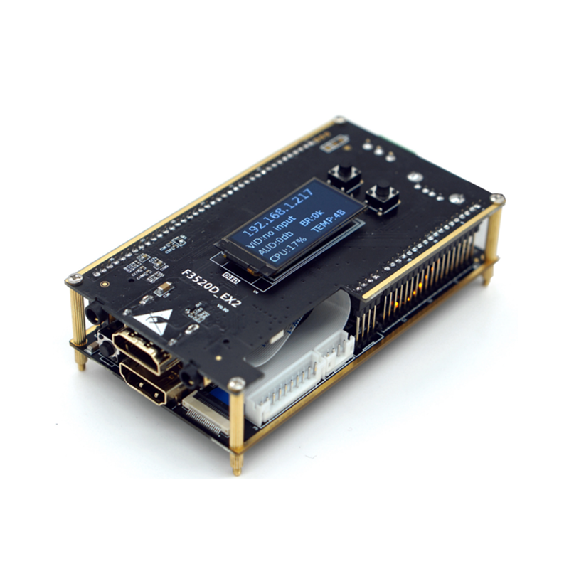
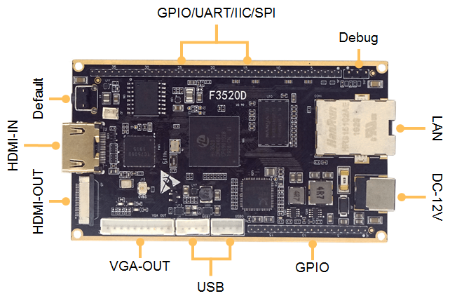

# Link Pi ENCx encoders

This repository documents the hardware, firmware behavior, security, and undocumented features of Link Pi ENCx video encoders and related TBS devices. It began as a personal reverse-engineering project after a TBS 2603SE and an ENC1 were found to share the F3520D platform. Because Link Pi reuses firmware across much of its product line, findings from one model can help explain another.

The devices covered here include ENC-Tiny/TinyENC1, ENC1 and ENC1V2, ENC2, ENC4, ENC5, ENC9, ENCSH, newer SS524/SS528/SS928 families, and TBS 2603 variants. See the [hardware reference](docs/hardware.md) for the model-to-CPU list and the F3520D pinout.

This is an unofficial community reference for information that is missing from vendor documentation or is available only in Chinese. The material combines personal testing, firmware analysis, vendor release notes, and reports from other owners. Firmware and hardware details vary by model and version, so check the qualifications on each page before applying a procedure.

## Start with a task

- [Identify models, known bugs, and undocumented features](docs/overview.md)
- [Review security findings and hardening steps](docs/security.md)
- [Recover from a failed update or apply device fixes](docs/maintenance.md)
- [Check model CPUs, power notes, and F3520D pinout](docs/hardware.md)
- [Explore firmware internals and hardware-accelerated AV details](docs/internals.md)
- [Browse the version-by-version firmware changelog](docs/firmware-changelog.md)
- [Find vendor documentation, firmware repositories, and related projects](docs/resources.md)

## Notable findings

- The firmware includes an internal RTMP server that can relay incoming streams. A local SRT listener is also documented, with limitations for HEVC streams.
- USB camera and mix-input pipelines have been reported to freeze after long runs on some firmware versions; snapshots and other pipelines may remain active.
- Firmware analysis documents SEI timestamp behavior and a May 2026 report of NTP-derived timestamp work for H.264, HEVC, and NDI.
- Historical security findings include default credentials, weak password storage, and exposed services. Read the [security notes](docs/security.md) before exposing an encoder to an untrusted network.

These are pointers into the detailed notes, not a guarantee that every finding applies to every model or current firmware.

## Firmware updates

The changelog currently includes vendor releases through **5.2.0, build 20260531**. Upgrade packages and full-flash recovery packages are different; a failed update may require the model-specific full-flash package. Back up important settings, verify the exact model, and follow the [recovery guide](docs/maintenance.md) before updating or recovering a device.

## Community

The [issue tracker](https://github.com/matiaspl/LinkPi-ENCx/issues) is used for questions, device reports, and corrections. If an answer is confirmed and useful to other owners, please help add it to the relevant Markdown page through a pull request.

## Disclaimer

This project is independent and is not affiliated with Link Pi or TBS. The notes are provided as-is and can be incomplete or outdated. Check the target model and firmware before making changes, and keep a recovery path available when modifying a device.
