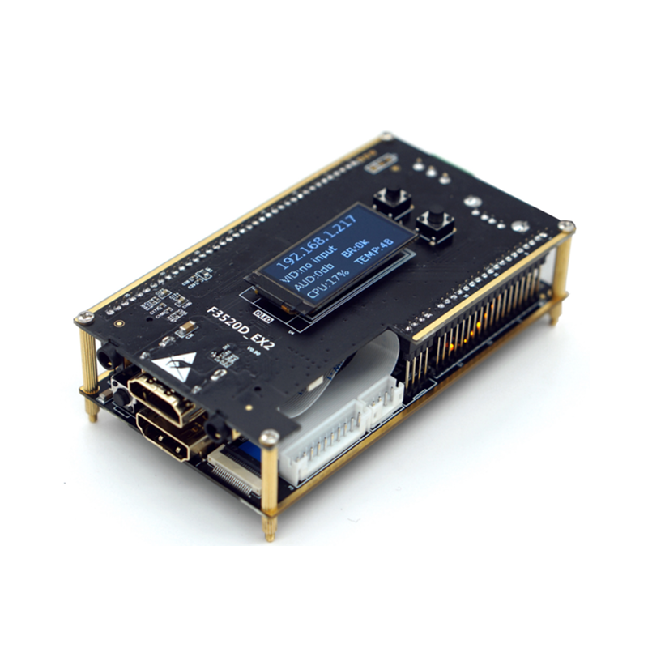
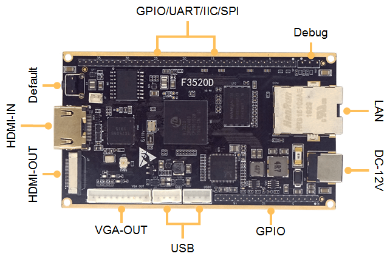

# Project overview and field notes

## Project background

This repository started in early 2021 as a place to document reverse-engineering work on a TBS 2603SE and a Link Pi ENC1. Both turned out to use the F3520D platform. Link Pi firmware is shared across much of the encoder family, so findings have often helped owners of related devices as well.

The project became an unofficial community reference for information that was missing from vendor documentation or available only in Chinese.

## Personal disclaimer
I have no connections to the LinkPi company or their developent process. My personal opinion is that they are great devices, more capable than some of 10x as expensive known-brand encoders. It has a well planned and responsive UI. The picture and audio quality is good and everything "just works". I'm kind of used not to expect much from a $100-ish video devices, so getting my hands on and testing ENC1 was an Eureka moment ;)

I tried contacting Link Pi (both dev and sales) about the security issues but unfortunately got no response, that's why I decided to write about all potential and real problems here.

It's a real pity that the Linux system underneath didn't get as much love as the UI, but a cautious linux beginner can make the device more secure in just a few steps.

For the model and CPU list, see [Hardware models and pinouts](hardware.md).

## Known bugs
* USBCam streaming output freezes if the encoder is left running for longer periods of time, e.g. more than 48h. The snapshot pipeline does not seem affected at the same time.
* Mix pipeline inputs freeze if left running for longer periods of time (e.g. more than 48h). The snapshot and streaming pipelines does not seem affected.

## Undocumented features
### Software
* ~~USBCam allows audio only streaming with a UAC device (e.g. USB microphone)~~ (official support for USB Audio since 5.1.0)
* internal RTMP server accepts connections from outside using rtmp://enc1_ip/live playpath and any stream key (avoid stream* and sub* keys - they are used internally), so it can be used as a relay
* since _**update_20210927**_ there's a local SRT server (SLS) in listener mode accepting connections with proper streamID. If the encoding party pushes it's stream to srt://enc1_ip:8080?streamid=push/live/XYZ and the player/decoder can connect to the stream here: srt://enc1_ip:8080?streamid=pull/live/XYZ (multiple client connections are supported.

Note: SLS's built in parser overwrites MPEGTS video headers with H.264 metadata, so you will have hard time playing back HEVC streams sent to SLS. Also, encyption is not supported.
* audio sampling rate up to 96 kHz is supported (but not enabled - it can be added manually by editing the right PHP script)
* ~~OPUS audio codec is supported (software only and disabled by default)~~ (no longer undocumented)
* As of [20231031](firmware-changelog.md) the encoder has support for adding timestamp information to SEI video stream in-band metadata. UI mentions sinsam ([specs](https://dw.sinsam.com/sinsam/software/%E8%8A%AF%E8%B1%A1SEI%20%E5%B8%A7%E5%90%8C%E6%AD%A5%E6%8A%80%E6%9C%AF%E8%A7%84%E8%8C%83V1.0%20202309.pdf)) and normal (~~I expect this to be "regular" SEI SMPTE-12M timecodes~~ same as sinsam alas not per packet but per GOP - tough luck...)

**UPDATE 17.05.2026** I'm currently working on adding NTP-derived S12M-1 timestamps (H.264, HEVC) and timecodes (NDI). The idea is to use LD_PRELOAD library hooks and take control over parts of communication that would normally flow directly between linklib libraries. In case of timestamps this replaces the "sinsam" mode which isn't very useful outside of China. In NDI it just overwrites the existing ones that start at zero when the encoder starts. Looks promising (it works). Kudos to AI :)

## 3rd party apps
Statically compiled armhf applications seem to work fine. I tried ffmpeg and v4l2-ctl and they both worked.
* LinkPi-oled-logo-converter: https://github.com/YveIce/LinkPi-oled-logo-converter - tool for converting your graphics to OLED boot logo format
* ffmpeg: https://johnvansickle.com/ffmpeg/
* v4l2-ctl: https://github.com/9crk/v4l2-ctl - there's a v4l2-ctl.exe file in this repo which is a static armhf binary
* v4l2ctl-ctl-with-php: https://github.com/wilwad/v4l2-ctl-with-php - allows remote control of USB webcams params (brightness/contrast/backlight, etc.)

## Interesting internal pages (not linked)
Some of the mentioned pages might no longer be available as the frontend has been significantly cleaned up during UI revamp.
* http://enc1/fac.php - _low level factory settings_ (also uses oled.php, themes.php and remote.php)
* http://enc1/ndireg.php - for entering the NDI license string (sold separately)

Engineering leftovers:

* http://enc1/demo/audio.php - audio mixer, frontend for [AB33EP expansion board](https://gitee.com/LinkPi/Audio/wikis/pages/preview?sort_id=1475161&doc_id=324053)
* http://enc1/demo/audio2.php - backend for audio.php?
* http://enc1/demo/config.html - looks like a "set defaults" script
* http://enc1/demo/rtmp.html
* http://enc1/demo/netex.php
* http://enc1/demo/netex%20-%20拷贝.php (removed in update_20210123)
* http://enc1/demo/timer.html - javascript timer, helpful for latency measurement
* http://enc1/demo/demo.html - face recognition, not working
* http://enc1/wxfunc.php - possibly a part of an old backend, allows non authorised changes
* http://enc1/test.html - possibly a QA leftover, allows unauthorised slideshow view of all inputs
* http://enc1/monitor.php - motion detection
* http://enc1/face.php - face recognition

## Intercom & tally
The intercom system (since version 20211201) is using an unknown UDP-based protocol on port 7000 for communication through a central server (source not public - installer and binaries located here: https://gitee.com/LinkPi/Service/). Judging by the symbols, the server is a QT app built on LinkLib. The client side runs inside the _/link/bin/Encoder_ process and utilizes LinkLib LinkIntercom interfaces

The tally system is able to utilize vMix and Sinsam (Chinese visual clone of vMix) APIs and the builtin UART (_/dev/ttyAMA1_) as the source of PGM/PVW signals sent downstream. The documentation states, that (as of 8.04.2022) only the vMix integration is complete.

Firmware analysis shows that the system relies on a specific "ttyTally" interface for the tally lights, that presents itself to the LinkPi box as _/dev/ttyUSB0_. Should work with basically any linux supported USB-UART chip (specifically with ESP/ESP32 and Arduino devices). As of 20220712, the udev rules select 10c4:ea60 (Silicon Labs CP210x UART Bridge) as the ttyTally device.

A generic USB UAC soundcard over ALSA seems to be the source and destination as the intercom communication device (may cause trouble if both webcam and intercom were to be used).

As of version 20220705/20220712 there are udev hotplug rules present for USB audio devices 08dc:0014 (C-Media - Unitek Y-247A) and 12d1:0010 (KTMicro KT USB Audio chip based device). Both create a symlink to /dev/headphone which very likely is used as audio IO for the intercom system.
